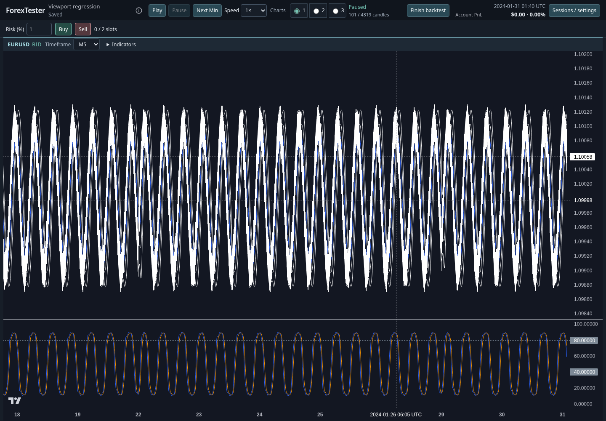
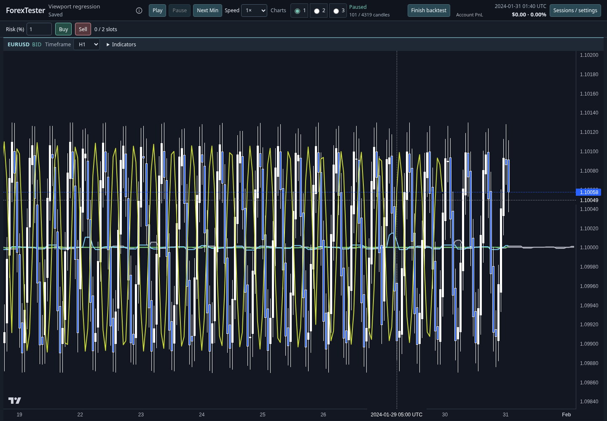
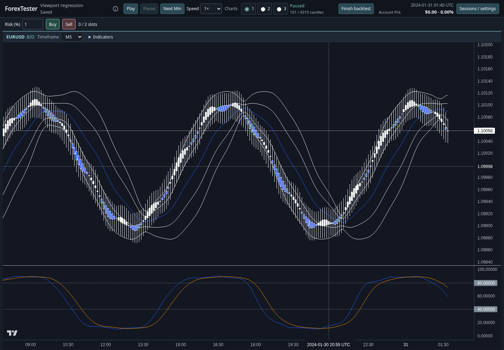
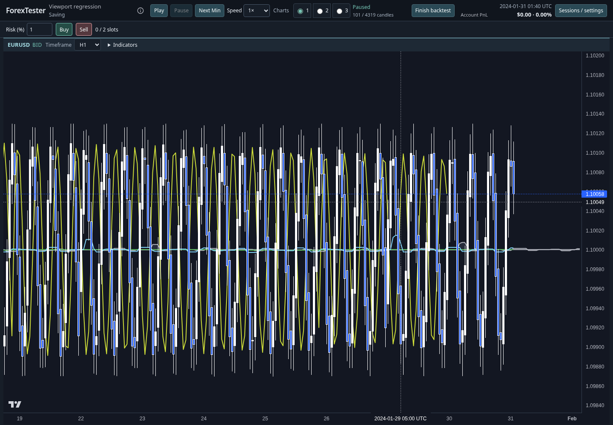
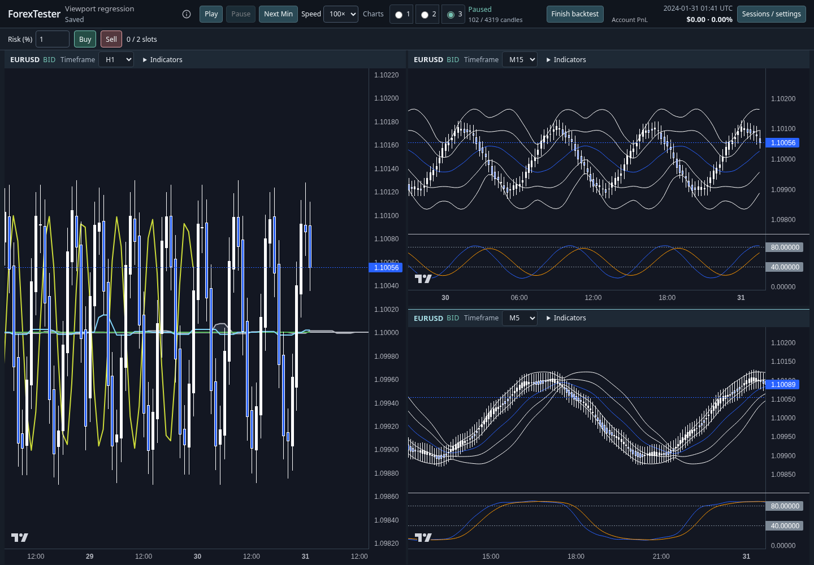
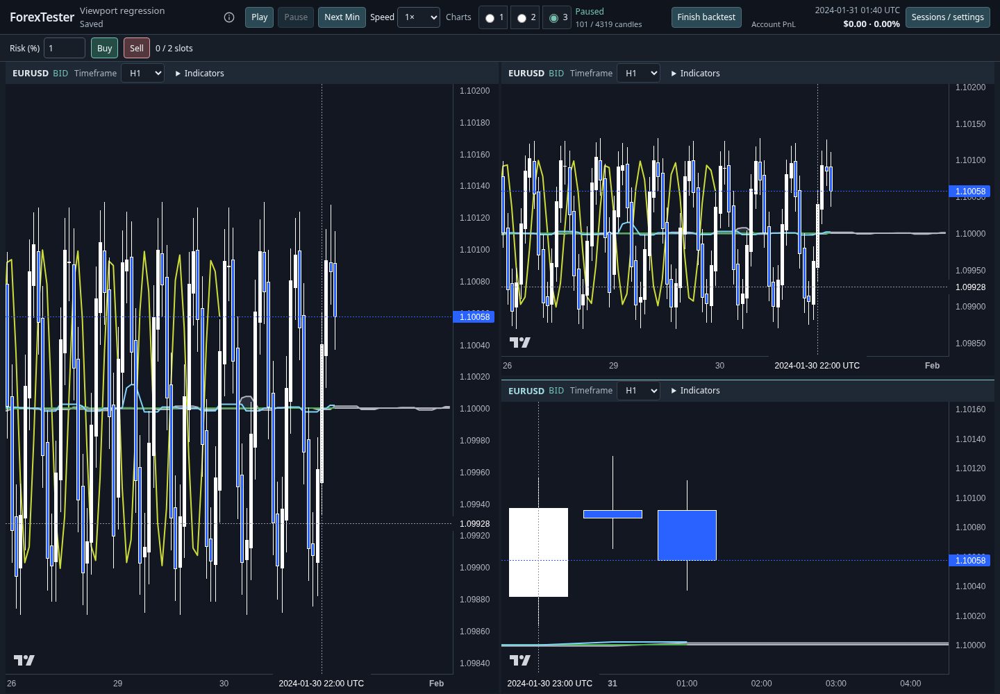
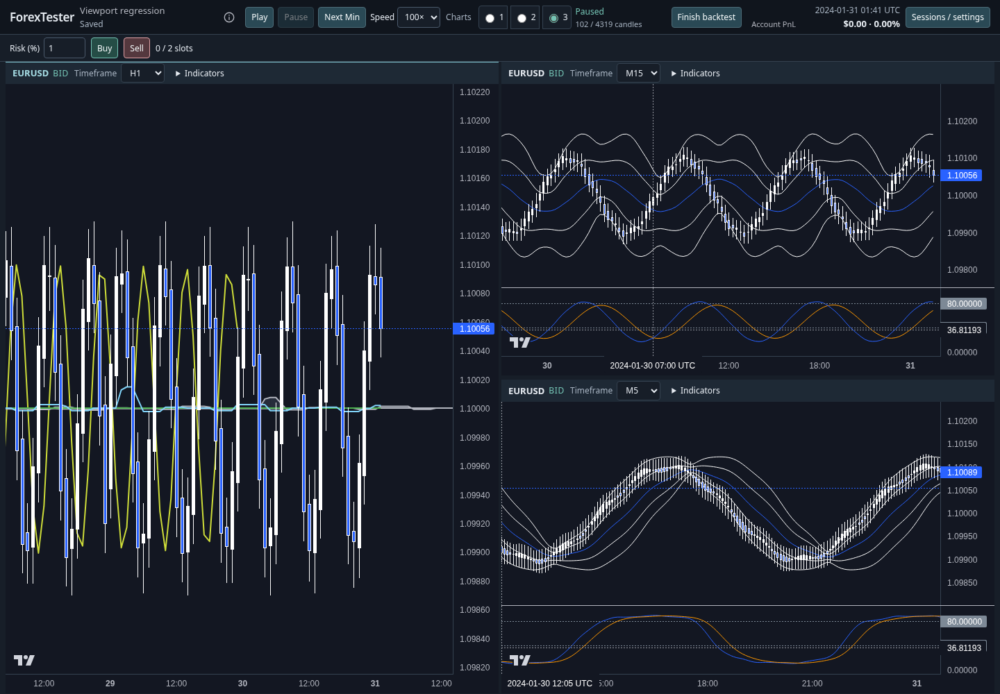

# Chart viewport regression verification

## Root causes and changes

`ChartSynchronizer.applyViewport` used the UTC duration to calculate a new logical width whenever the timeframe changed. In the original Chromium reproduction, H1's 225-bar span at 6.01 px per bar became a requested 2,700-bar span on M5. Lightweight Charts clamped the rendered spacing to 0.5 px. The saved requested range and rendered range then disagreed.

The fix preserves the logical span across timeframe changes. Following panes anchor to the replay edge; historical panes map their right UTC anchor into the target data. Manual future whitespace stays a bar count. Removing the loaded-history cap from timeframe restoration prevents a coarse timeframe with few candles from permanently shrinking the zoom on the return trip. No viewport schema change is needed; legacy UTC-only saves retain their fallback conversion.

`ChartPane` left the current price scale untouched when the target timeframe had no saved preference. Its passive effect also saved the departing timeframe after the candle-data layout effect had already replaced its data. Price persistence now runs in a layout effect before data replacement: cleanup saves the old scale, then the target restores its own saved range or starts with autoscale. The existing public price-scale APIs remain in use.

The right-whitespace constraint used the entire projection margin even when that margin exceeded the visible width. A five-bar viewport could therefore pan entirely beyond its candles. Both native range callbacks and wheel zoom now enforce a five-bar minimum and limit future whitespace to leave two logical bars for candle bodies. Normal projection margins and the existing wider-view whitespace limits remain available.

Native bottom-axis dragging was already enabled. Wheel events over the bottom axis were excluded from the custom horizontal wheel handler while native wheel scaling was disabled. The handler now includes the bottom axis. Horizontal gestures share the same range constraints, and vertical axis wheel scaling stays separate. The library's `lockVisibleTimeRangeOnResize` option preserves the span during chart and price-axis resizing.

In multiple-chart layouts, pointer movement into a neighboring pane activated that pane while Lightweight Charts continued dragging the original chart. The original chart's range callbacks were then ignored. Pointer capture now retains ownership on the section where a canvas drag began. Capturing applies to the chart canvas, leaving toolbar controls available normally.

Finally, `setVisibleLogicalRange` schedules its target for rendering. Reading `getVisibleLogicalRange` immediately afterward can return the previous range. Pending callbacks now track the requested target instead of that stale read. A deferred-render regression test covers this behavior.

The changes use the existing synchronizer, persistence schema, and public Lightweight Charts APIs. Candle aggregation, history, indicators, order execution, financial calculations, and saved trading records are unchanged.

## Chromium evidence

The harness runs the production `App`, `ChartPane`, synchronizer, indicators, replay, UI preferences, and disk session store with real Lightweight Charts and real Chromium mouse input. A test-only Vite transform exposes references to public chart APIs for assertions; no test hook ships in production. Sessions and deterministic M1 history live on a disposable backend. Provider discovery is intercepted and external requests are blocked.

| Measurement | Original H1 | Original M5 | Fixed H1 | Fixed M5 | Fixed return to H1 |
| --- | ---: | ---: | ---: | ---: | ---: |
| Rendered logical span | 225 | 2,691 | 225 | 225 | 225 |
| Bar spacing, px | 6.01 | 0.50 | 6.01 | 5.96 | 6.01 |

The small spacing difference between H1 and M5 follows the different price-axis widths. The logical span stays identical.

Original H1 and M5 after switching:




Fixed H1, M5 after switching, and H1 after returning:







The cross-pane drag failure found during investigation, before the pointer-ownership fix:



Narrow zoom with a full Ichimoku projection in a three-chart layout, after dragging across a pane boundary:



Reloaded session with different timeframes, horizontal viewports, indicators, and manual vertical ranges:



Raw measurements: [original reproduction](before/browser-evidence.json), [fixed regression run](after/browser-evidence.json).

## Regression coverage

- Unit tests cover repeated H1/M5, M5/H1, H4/M15, and H1/D1 round trips, sparse coarse-timeframe history, fractional historical anchors across a weekend, manual future margins, deferred range callbacks, empty/single-candle initialization, narrow projection margins, independent pane navigation, replay recovery, and JSON restoration.
- Chromium tests exercise every pane in 1-, 2-, and 3-chart layouts. They drag the native bottom axis in both directions, wheel over the plot and bottom axis, pan historically, cross pane boundaries, resize between 1,440 px and 1,100 px, switch repeatedly among M5/M15/H1/H4/D1, and verify other panes' ranges stay unchanged.
- Vertical checks cover native price-axis dragging, price-axis wheel scaling, unsaved timeframe defaults, saved autoscale preferences, saved manual preferences, and exact restoration of independent price ranges. Horizontal ranges are asserted independently.
- Five-bar zoom and future panning assert that candle closes and the replay candle's coordinates stay inside the plot. A real-library fixture covers empty initialization, one candle, batched loading, incremental updates, a weekend gap, and Ichimoku projection slots.
- Paused historical inspection remains fixed beyond activation expiry and through keyboard history review. A new forward observation recovers an offscreen chart. Playback and switching while replay advances retain visible candles.
- Reload resumes a disposable disk-backed session with three distinct viewports and manual price ranges. The test verifies timeframes, ranges, and unchanged saved trading state after restoration.

Reproduce the browser checks using an existing Playwright installation:

```bash
PLAYWRIGHT_MODULE=/absolute/path/to/playwright-core/index.mjs \
  CHROMIUM_PATH=/absolute/path/to/chromium \
  node --import tsx scripts/chart-viewport-browser.mts
```

## Validation results

- `npm test -- --maxWorkers=2 --testTimeout=30000`: **60 files, 830 tests passed** in 201.95 seconds. The initial default-parallel run exceeded the existing five-second timeout in three archive/indicator tests and was stopped while the workflow file was still running. The complete bounded rerun passed without changing repository timeout settings or skipping tests.
- `npm run typecheck`: frontend and backend passed.
- `npm run build`: frontend production bundle and backend build passed. Vite retains the existing warning about the application bundle exceeding 500 kB.
- Real Chromium regression: **11 scenario groups passed**, including every pane in every layout; zero page errors and zero external requests.
- `git diff --check`: passed.

No dependency was added. The fixture uses headless Chromium on Linux. Touch/pinch and other browser engines are not covered. A coarse timeframe cannot display more historical candles than are loaded; it retains the span with left whitespace so the return trip keeps the original zoom. An explicitly saved manual price range remains intentional and is restored as saved.

Lightweight Charts references: [logical ranges and time scale](https://tradingview.github.io/lightweight-charts/docs/time-scale), [native axis scaling options](https://tradingview.github.io/lightweight-charts/docs/api/interfaces/HandleScaleOptions), [resize and spacing options](https://tradingview.github.io/lightweight-charts/docs/api/interfaces/TimeScaleOptions).
