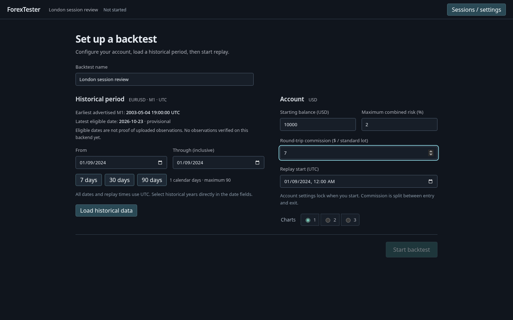
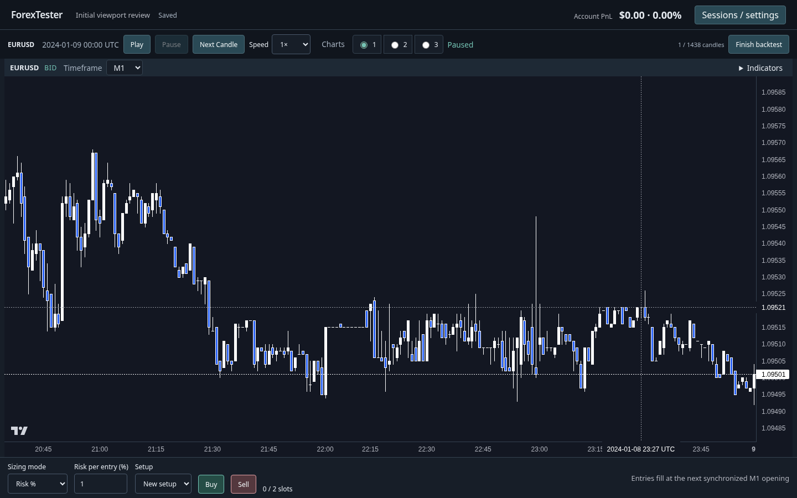
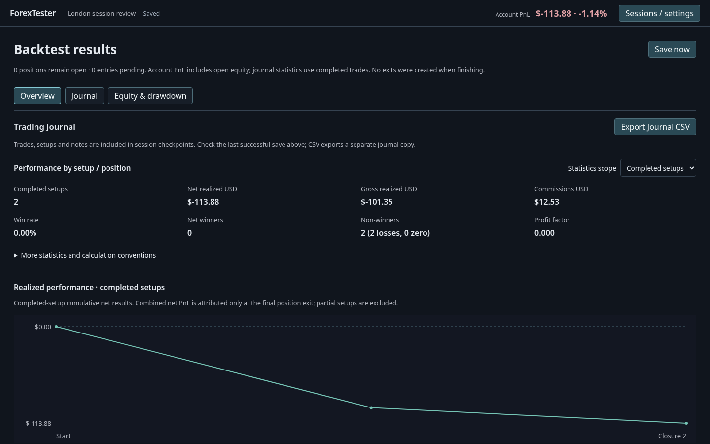

# Task 20 verification

Verified on October 24, 2026, on the target Linux machine (Fedora 44, Node 24.18). This report distinguishes live provider checks from deterministic execution fixtures.

## UX and screenshots

[Annotated wireframes and transitions](design.md) describe Setup → Trading → Finished. Setup requires an explicit download; Trading mounts the chart stack and compact dock; Finished mounts Overview, Journal, or Equity & drawdown. Administration lives in a modal. Account PnL uses current ledger equity minus starting balance, including incurred fees, with an unavailable state for missing required quotes.

| Before | After |
| --- | --- |
| [Original long page](before.png) | [Setup](setup-1440.png), [Trading with real Dukascopy history](trading-live.png), [Results](results-1440.png) |

Additional captures: [1728 setup](setup-1728.png), [1728 trading](trading-1728.png), [1728 results](results-1728.png), [mobile setup](setup-390.png), [mobile trading](trading-390.png), [mobile results](results-390.png), [two charts](trading-2-charts.png), [three charts with indicators](trading-3-charts.png), [equity and drawdown](results-equity.png). Fixture screenshots use synthetic prices to make stop execution reproducible; the real-history screenshot is separately identified.

Measured with two open positions and the dock visible:

| Viewport | Chart canvas | Actual price plot | Canvas / viewport height | Price / viewport height |
| --- | --- | --- | --- | --- |
| 1440 × 900 | 1424 × 652 px | 1358 × 624 px | 72.44% | 69.33% |
| 1728 × 864 | 1712 × 616 px | 1646 × 588 px | 71.30% | 68.06% |
| 390 × 844 | 390 × 368 px | 324 × 340 px | 43.60% | 40.28% |

The canvas occupies 77.07% / 76.05% of desktop height after the 54 px application header. Price plot measurements exclude time and price axes. Mobile deliberately scrolls vertically to preserve a usable chart. No page-wide horizontal overflow was found at the three requested sizes. Three stacked charts share the workspace, including Stochastic, without the old pane minimum heights pushing charts over one another.

The independent finish review returned **Pass**. Both findings were resolved: mobile trading input sizes are 16 px, and the starting-balance accessible name matches its visible label. The harness did not expose the named Impeccable reviewer/documenter roles, so fresh agents performed those scoped handoffs using the skill references.

## PR #18 initial viewport fix

`ChartSynchronizer.initializeViewport()` now uses up to 200 observed candles on the first populated chart, anchored to the revealed replay edge. Observed timestamps account for weekends and missing minutes. Standalone M1, M5, M15 and H1 start with 200 candles when available; H4 uses up to 200, which was 123 with this real 30-day pre-roll. Mixed layouts retain one shared UTC horizon chosen by their first populated chart. Adding a pane or changing its timeframe preserves that horizon. A saved custom viewport takes precedence, including its following preference; following restores retain the saved width at the recovered replay edge.

The updated [fresh M1 screenshot](trading-live.png) is captured at 1440 × 900 without wheel zoom. Real Dukascopy EURUSD history for January 9, 2024, with the preceding warm-up, installs **27,712 revealed M1 candles** and initially displays **200**. Horizontal spacing is **6.79 px**; 164 visible bodies measure at least 2 px vertically and 184 visible high/low spans measure at least 4 px. Older prices remain reachable, including the earliest installed candle. [Mixed M5/M15/H4](trading-viewport-mixed.png) retains Ichimoku forward projection; [restored custom navigation](trading-viewport-restored.png) retains the exact saved UTC range with following disabled.

[Viewport browser evidence](viewport-live-verification.json) records every standalone timeframe, three-chart synchronization, public wheel zoom/drag navigation, follow-replay, a manual viewport held through replay and reload, restoration without another history request, and zero unrevealed price candles or page exceptions. It distinguishes forward indicator points from future OHLC. The verification server exposes chart API handles through a test-only Vite transform; production code gains no debug interface. Sessions use an isolated temporary directory. The provider cache may reuse downloaded history.

Reproduce with `node --import tsx scripts/task20-viewport-browser.mts`. `REPRESENTATIVE=1` selects deterministic weekday history with a 30-day warm-up instead of the provider. The earlier `task20-live-browser.mts` also captures the default viewport without applying manual zoom now.

Fifteen added unit cases cover initial ranges on all five timeframes, partial buckets, weekends, short history, delayed data installation, remount/timeframe stability, three mixed layouts, full-history navigation, follow-replay, projection and saved custom ranges. The existing synchronization assertions remain, with the navigation-only call count reset after the newly necessary initial zoom.

The late 90-day Task 19 isolated three-chart benchmark was rerun using `DIRECT_ONLY=1 DAYS=90 SCENARIO=D node --import tsx scripts/chart-replay-browser.mts viewport-fix-late`: 12 batches of 100 M1 observations, **61.42 ms mean / 81.50 ms p95** synchronous JavaScript with the pointer over chart 1. [Performance evidence](viewport-performance-verification.json) records incremental candle/indicator updates, no `candles.setData` calls during measured playback, and no browser errors. This is a local smoke check, not a new throughput guarantee. The production diff changes only initial viewport selection; execution, financial calculations, persistence schemas, underlying prices and indicator warm-up remain unchanged.

`npm test` passed **37 files / 486 tests**. Typecheck, build and diff validation passed. An initial concurrent test/build/browser run timed out one existing indicator-reference test at 5 seconds; the subsequent full test run passed without competing build/browser work. The existing bundle-size warning remains.

## Live provider verification

Installed `dukascopy-node` is 1.51.0 and its `playwright-core` is 1.64.1. `npx dukascopy-node --install-browser` completed successfully, installing regular Chromium revision 1248 through the Ubuntu 24.04 fallback build. The old installed revision alone was insufficient. Existing Linux libraries were sufficient; `--with-deps` was investigated but no privileged packages were installed.

The backend performs a sandboxed launch preflight using the provider's own Playwright. On Linux an executable wrapper removes upstream sandbox-disabling flags. Sandbox failure remains a failure. `DUKASCOPY_CHROME_PATH` selects a configured executable through the same wrapper. The library's WAF flow is unchanged; there is no access-protection bypass. Seven-day chunks, two concurrent workers and the XDG cache remain intact.

The first cold request completed in 20.390 seconds and the second in 37.648 seconds. The live API script starts a fresh backend and immediately requests January 9, 2024, then a second range, February 5–6. Both bid and ask arrays are nonempty with original OHLC values. [Provider evidence](provider-verification.json) records counts, timings, sample prices and resulting coverage. The final run uses a fresh external temporary cache, so these are network downloads rather than fixture or cached-only success.

| Inclusive selected period | Bid M1 observations | Ask M1 observations |
| --- | --- | --- |
| January 9, 2024 | 1,438 | 1,438 |
| February 5–6, 2024 | 2,873 | 2,873 |

[Live browser evidence](live-browser-verification.json) also records successful real React → backend → provider loading of January 9 plus its 30-day pre-roll: six successful chunk responses, sandbox enabled, no browser exceptions. [Loaded setup](setup-live.png) and [trading](trading-live.png) are screenshots from that run. Its cache may reuse earlier successful downloads; the fresh-cache API run above establishes cold startup behavior separately.

Coverage reads `instrumentMetaData.eurusd.startDayForMinuteCandles`. Installed metadata is **2003-05-04 19:00 UTC**, while the [published EURUSD page](https://www.dukascopy-node.app/instrument/eurusd) lists **21:00 UTC**. The endpoint reports the installed value; both imply May 4 as the first selectable calendar date. The latest completed UTC date is provisional, and last verified date means a date with observed synchronized bid/ask data in this backend process, not full-day completeness. Browser launch, missing libraries, WAF, network, temporary data and invalid-range failures have distinct sanitized codes/messages/actions.

## Execution and recovery

Chart placement uses public crosshair/click events and candlestick `coordinateToPrice`. Only pane 0 accepts placement. The clicked candle's time and historical price are irrelevant. Hover previews a line; click selects; confirmation queues the existing execution request. Risk preview uses observed prices, and the engine sizes risk orders again at the future synchronized M1 opening. Escape, replay start, restart and session switch discard drafts.

The Chromium fixture run created two Buy entries in one setup with separate chart-selected SLs, modified the first through the chart, stopped only that entry, manually closed the other, then entered and manually closed a Sell. [Downloaded CSV, with line endings normalized for Git](browser-journal.csv) preserves the execution evidence:

| Position | Lots | Initial SL | Final SL | Exit | Net USD |
| --- | --- | --- | --- | --- | --- |
| 2-1 Buy | 0.69 | 1.09896 | 1.09925 | Automatic stop | -84.18 |
| 2-2 Buy | 0.42 | 1.09804 | 1.09804 | Manual | -11.34 |
| 2-3 Sell | 0.68 | 1.10165 | 1.10165 | Manual | -18.36 |

Finish pauses and saves before confirmation, discloses open/pending counts, and persists Finished without inventing exits. A failed finished checkpoint returns to Trading. Notes stay editable in Results. Schema 2 adds lifecycle; valid schema-1 digests are checked before mapping unstarted → Setup, started → Trading, complete → Finished. Financial state, history fingerprints, exclusive ranges and equity chunks remain intact. Restores pause active sessions and reopen finished Results without downloading a valid saved dataset. Draft stops are never serialized.

## Automated checks

`npm test`: **37 files, 486 tests passed**, including the startup and initial-viewport regressions. `npm run typecheck`, `npm run build`, and `git diff --check` passed. Build retains the existing large-bundle warning; no runtime dependency was added.

All prior regression assertions remain. The 61 legacy `App.interaction.test.tsx` cases use an explicitly test-only `RegressionWorkspace` composition of the former controls with current production chart, replay, trading, journal and persistence components. They do not claim to validate new navigation. `workflow.test.tsx` tests the production three-phase App under StrictMode, and Chromium scripts exercise the real new UI and Lightweight Charts.

Acceptance-test mapping:

| Requested cases | Evidence |
| --- | --- |
| 1–6 setup, no download, coverage, bounds, inclusive conversion, invalid ranges | `workflow.test.tsx`, `historyCoverage.test.ts`, `history.test.ts`, `app.test.ts` |
| 7–9 provider errors, classification, retry | `historyCoverage.test.ts`, `providerBrowser.test.ts`, `historyLoader.test.ts`, production workflow error/retry tests |
| 10–14 account setup/lock, chart workspace, USD/% PnL and missing quotes | `workflow.test.tsx`, `equity.test.ts`, Chromium layouts |
| 15–22 Buy/Sell, side validation, oscillator rejection, cancellation, confirmation, independent stops | Production workflow tests and Chromium chart clicks on every timeframe |
| 23–30 risk cap, bid/ask fills, close, stops, modifications/history, paused-only requests, draft cleanup | `trading.test.ts`, `risk.test.ts`, `stopLoss.test.ts`, `setupGrouping.test.ts`, production workflow and Chromium |
| 31–38 finish, results visibility, financial statistics, migration/recovery, CSV | Production workflow, `analytics.test.ts`, `commissions.test.ts`, equity/recovery/migration tests, `journalCsv.test.ts`, Chromium finished refresh and downloaded CSV |
| 39–42 layouts, synchronization, no lookahead, StrictMode | Chromium 1/2/3 layouts, real crosshair/viewport checks, `chartSync.test.ts`, `replayBars.test.ts`, existing regression composition and production workflow |

[Browser results and dimensions](browser-verification.json) record zero page exceptions. The script also confirms oscillator-pane clicks do not select an SL, chart clicks alone do not queue an order, every available timeframe accepts price placement, the journal is absent during Trading, notes save after finishing, and finished restore makes no history request.

## Reproduce and limitations

### Refresh with older browser sessions

A reported refresh bug exposed Setup briefly, then forced the migration drawer when only an older IndexedDB backtest existed. Discovery now shows a short loading state; legacy-only discovery leaves Setup usable with an optional **Review browser backtests** action. Disk sessions still receive the existing session-selection flow. No browser record is deleted or imported automatically.

`node --import tsx scripts/task20-startup-browser.mts` seeds an isolated browser session, delays discovery, refreshes twice, checks Setup stays available without a modal or download, opens/closes migration, and imports the original successfully. [Browser evidence](startup-verification.json), [desktop](startup-legacy-1440.png), and [mobile](startup-legacy-390.png) captures verify the reported case. Production StrictMode regression coverage also checks the original digest is unchanged.

Commands and browser setup are in the [README](../../README.md#repeatable-dukascopy-browser-setup-on-linux). Scripts use isolated temporary session directories, leaving real backtests untouched. Live scripts require network/provider availability. They use verification tooling already available in the local environment (`tsx`, `playwright-core`) rather than adding production dependencies.

Before the first successful load, setup fields remain an unsaved draft. Loaded Setup, Trading and Finished checkpoints are durable. Cancel aborts frontend requests and ignores obsolete responses; the provider library cannot cancel work already running on the server, which may finish filling its cache. Provider metadata and newest-day uploads can differ; calendar eligibility never proves observations exist. Native date fields support direct year editing, with appearance depending on the user's browser. Browser measurements are local Linux Chromium results, not a guarantee for every device or browser. No financial formulas, execution assumptions, automated strategies, signals or take-profit functionality were introduced.
